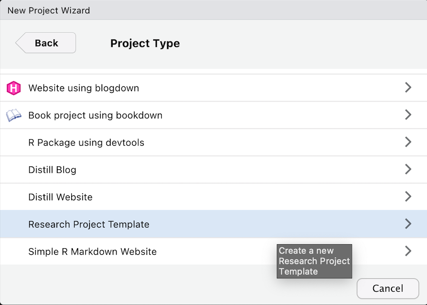
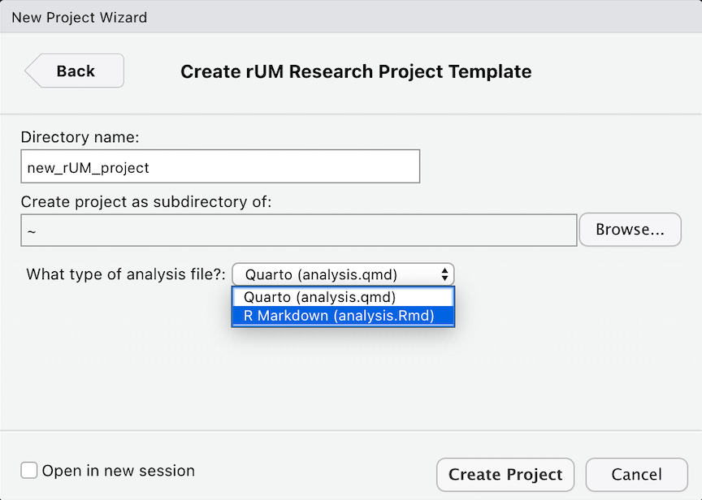
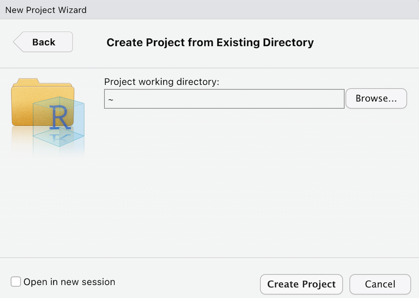
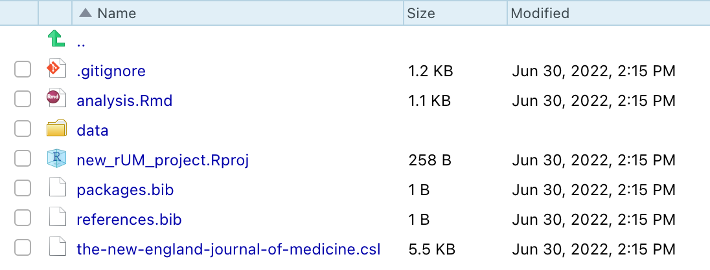
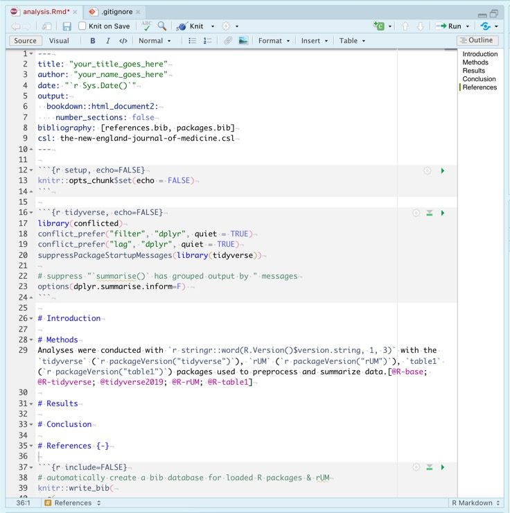
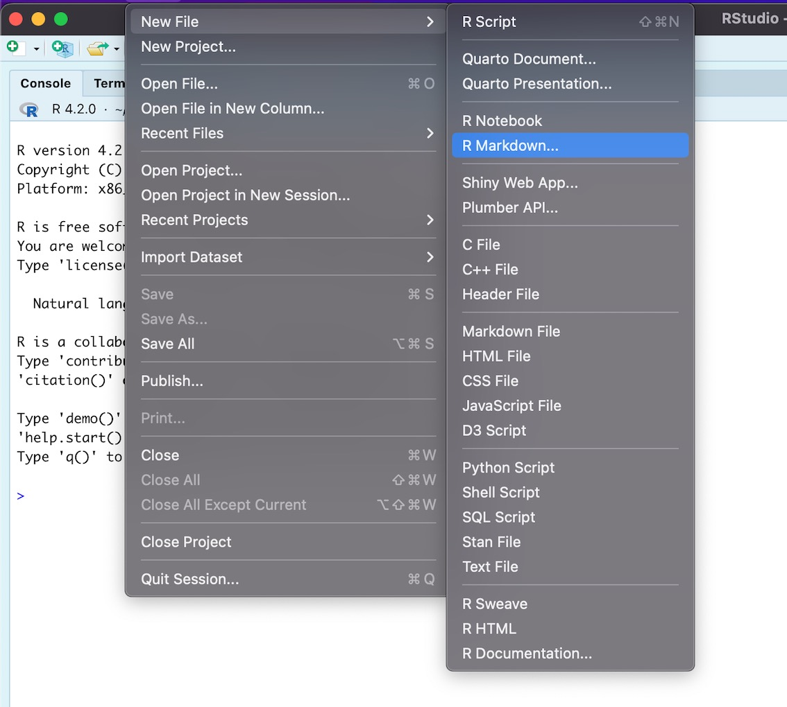
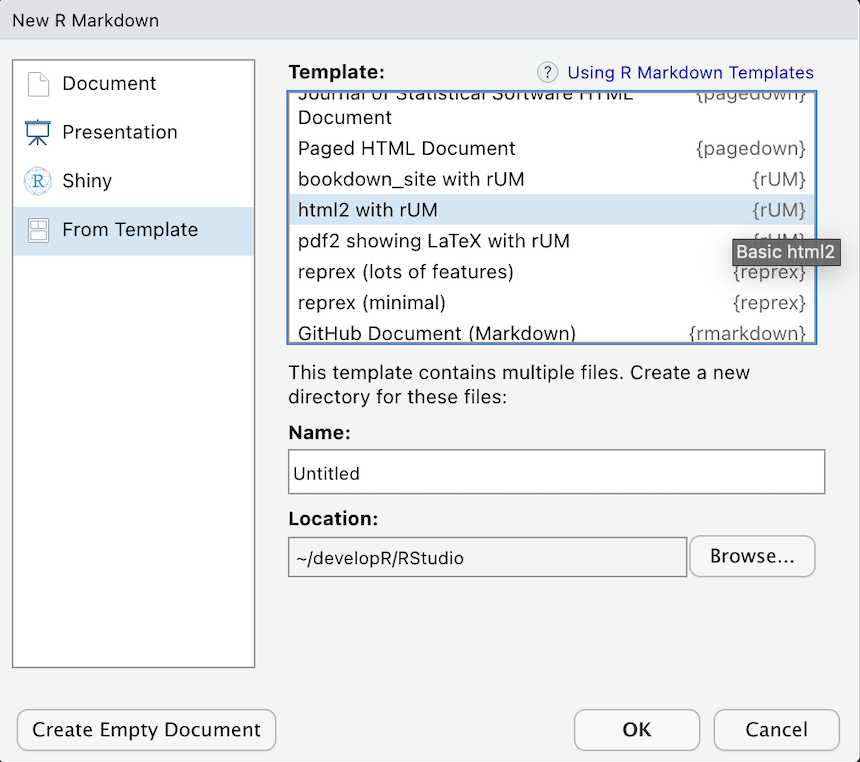

```{r include = FALSE}
knitr::opts_chunk$set(
  collapse = TRUE,
  comment = "#>"
)

options(rmarkdown.html_vignette.check_title = FALSE)
```

```{css, echo=FALSE}
body > h1 > img {
  position: relative;
  bottom: -30px;
  border: 0px solid rgba(0, 0, 0, 0.1);
 }
```

## Introduction
This is a collection of document templates, available through R, from your friends at the University of Miami (UM). $R+UM=rUM$

The `rUM` package will help you create research manuscripts by removing the configuration hassles commonly encountered when learning to write papers using R. `rUM` will initialize a new RStudio project and an R Markdown file that includes the outline for a research paper. The R Markdown file comes preconfigured with a YAML header (don't worry if you don't know what that means yet) with code chunks to load the `tidyverse`, `tidymodels`, `conflicted`, and (when installed) `arrow` packages. Manuscript sections have been created for Abstract, Introduction, Methods, Results, Discussion, and References. The project also includes a `.gitignore` file which is designed to help protect against accidentally leaking data when using git with websites like [www.github.com](https://github.com/).

rUM's documentation can be found here:

-   <https://raymondbalise.github.io/rUM/>
-   <https://github.com/RaymondBalise/rUM>

## How do I get `R Markdown` and `rUM`?

1.  Modern version RStudio (v2022.07 or later) ships with R Markdown integrated into the RStudio IDE.

2.  Add `rUM` to your computer by:

    -   using RStudio: click on the Packages tab in the bottom right windowpane, click the Install button, type ***rUM***, and click Install.
    -   downloading rUM from CRAN and installing it by running this code in R console:

    ``` r
    install.packages("rUM")
    ```

    -   downloading the latest version of rUM from GitHub by running commands into the R console:

    ``` r
    if (!requireNamespace("remotes")) install.packages("remotes")
    remotes::install_github("RaymondBalise/rUM")
    ```

3.  Use `rUM` by running this in the console of RStudio:

``` r
library(rUM)
```

## Ordering `rUM` from the Menu

To create a research project that uses `rUM`, follow these steps. This will initialize a new RStudio project that has an [`analysis.Rmd`](#fig:analysis_Rmd_file) R Markdown file using the `tidyverse` and `conflicted` packages and some other useful files which are described [below](#stuff).

1.  Using the RStudio menus, choose: File \> New Project \> New Directory

2.  Scroll down and then select **`rUM` Research Project Template**

    {width=70%}

3.  Specify the location of where your research project will be saved

    {width=70%}
    

## Add `rUM` into an existing folder/directory that does not have an RStudio project.

What if you have already created a folder containing the important files for your project? Create a new project in your existing folder! This will now be your project directory (complete with a `.Rproj` file).

1.  Navigate to File \> New Project \> Existing Directory

2.  Specify the location of where your research project will be saved

    {width=70%}
    
3.  Run the following script in your console:

``` r
# Change the text inside the quotes on the next line to indicate the path to your folder/directory.
PATH <- "~/Documents/blah"   

rUM::make_project(PATH, type = "R Markdown")
```

## After your `rUM` has been served {#stuff}

A new project directory has been created and it will be populated with [these files](#fig:created_rUM_markdown_files):

-   An aggressive `.gitignore` to help prevent the unintended sharing of sensitive study information or protected health information (PHI).
-   [`analysis.Rmd`](#fig:analysis_Rmd_file) is an R Markdown template for writing your research project. It has a preconfigured YAML header; Abstract, Introduction, Methods, Results, Discussion, and References sections; and a code chunk to construct your bibliography using `knitr::write_bib()`.
-   A `README.md` template containing structured sections for comprehensive project documentation, including study details, setup instructions, and file descriptions.
-   AI coding assistant instructions (`AGENTS.md`, `CLAUDE.md`, `GEMINI.md`) and `.agents/skills/` (`rum-workflow`, `rum-devlog` for `DECISIONS.md` and `CHANGELOG.md`, and `rum-commit`) tailored to `{rUM}` research projects. See the [Built-in AI Coding Assistants and Project Skills](ak_ai_agents_and_skills.html) vignette for details.
-   An empty folder named `data`. This folder is listed within the `.gitignore`. That means that git should not track these files. This should help prevent data leakage but be sure to talk to a data security expert before sharing any biomedical projects on websites like GitHub.
-   A `.Rproj` file with the same name as your project folder.
-   A `bib/` folder containing two bibliography files (`bib/packages.bib` and `bib/references.bib`) and three bundled Citation Style Language (`.csl`) files: [`apa.csl`](https://www.zotero.org/styles?q=id%3Aapa) (*American Psychological Association 7th edition*, set as the default), [`mla.csl`](https://www.zotero.org/styles?q=id%3Amodern-language-association) (*Modern Language Association 9th edition*), and [`the-new-england-journal-of-medicine.csl`](https://www.zotero.org/styles?q=id%3Athe-new-england-journal-of-medicine) (*New England Journal of Medicine*). Refer to the Methods and References sections within [`analysis.Rmd`](#fig:analysis_Rmd_file) for examples of how to add and use citations.

Newly created files:

```{=html}
<br>
<p id="fig:created_rUM_markdown_files" >
</p>
```    
{width=70%}
  
`analysis.Rmd`:

```{=html}
<br>
<p id="fig:analysis_Rmd_file" >
</p>
``` 
{width=80%}


## `rUM` infused Markdown headers

1. Navigate to File > New File > R Markdown

    {width=70%}

1. Select **From Template**

    {width=70%}

1. Choose a template:

* html2 with rUM
* html2 Details with rUM
* pdf2 showing LaTeX with rUM
* bookdown_site with rUM

This saves the `.Rmd` file directly in the directory you select (rather than creating an extra nested subdirectory). When choosing **bookdown_site with rUM**, save the root file as `index.Rmd`; default `style.css` and `bibliography.bib` files are copied automatically into the same directory.


### What are the headers

#### html2 with rUM
This is a basic web page

#### html2 Details with rUM
This is a basic web page with a table of contents

#### pdf2 showing LaTeX with rUM
PDF report where table and figures don't float to other pages. 

#### bookdown_site with rUM
A bookdown website with a good table of contents for a book

### Session

If you are new to R, ignore this.

```{r}
sessionInfo()
```

